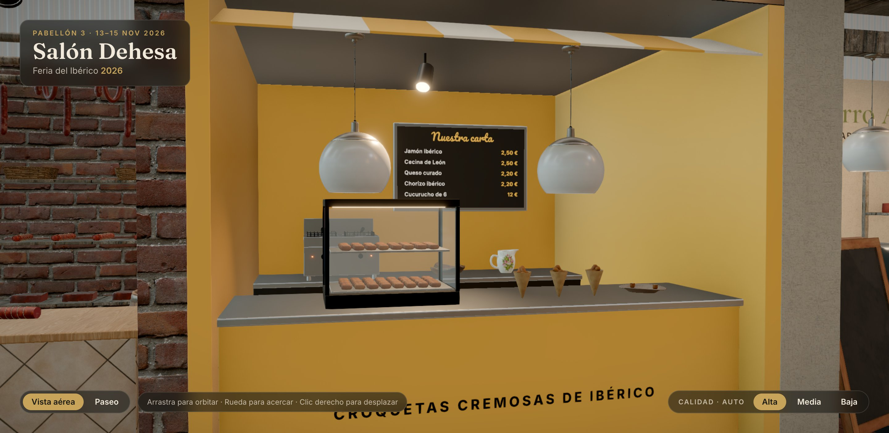

# Doña Brava Croquetería · Croquetas

> Kiosco de 9 m²: street-food moderno en mostaza y negro, con rótulo de neón, expositor
> calefactado lleno de croquetas, freidora y carta retroiluminada.

## Ficha

| | |
|---|---|
| Código de parcela | D-52 |
| Tipo y tamaño | Kiosco · pequeño · 3 × 3 m (9 m²) |
| Parcela (pabellón) | x −3,5 … −0,5, z 2 … 5 |
| Lados a pasillo | Norte (Avenida Central) |
| Frente principal | Norte |
| Altura máxima | 3,5 m |
| Estado | Terminado (fase 5) |

## Expositor

- **Doña Brava Croquetería**: «Croquetas cremosas de ibérico». Desde 2019, Madrid.
- Bechamel de leche fresca, rebozado crujiente en panko y rellenos con producto ibérico de la
  propia feria.
- **Identidad:**
  - Tipografía Pacifico.
  - Mostaza `#f2b134`, negro `#161616`, coral `#ff5a3c`, papel `#fbf3e4`.

## Arquitectura

- **Suelo:** azulejo.
- **Caja del kiosco:** paredes mostaza de 2,7 m, techo y frontis negros.
- **Rótulos:** de neón en el frontis, con toldo a rayas debajo.

## Mobiliario y producto

- **Mostrador de venta:**
  - Mide 2,8 × 0,7 × 1,05 m, con tapa de acero.
  - Expositor calefactado (`vitrinaCaliente`) lleno de croquetas.
  - Cucuruchos de croquetas y tabla con medias croquetas abiertas.
- **Mostrador trasero:**
  - Mide 2,8 × 0,6 × 0,95 m.
  - Freidora profesional doble (`freidora`), cuenco y jarra.
- **Carta retroiluminada:**
  - Jamón ibérico, 2,50 €.
  - Cecina de León, 2,50 €.
  - Queso curado, 2,20 €.
  - Chorizo ibérico, 2,20 €.
  - Cucurucho de 6, 12 €.
- **Lámparas colgantes.**

## Iluminación

Un foco real sobre el expositor.

## Archivos

- **Configuración:** `src/config/stands/croquetas.ts`.
- **Cotas y colisiones:** `CROQUETAS` en `src/config/layouts.ts`.
- **Escena:** `src/scene/stands/CroquetasStand.tsx`.
- **Modelos:**
  - `blender/build_products.py`: `croqueta`, `croqueta_abierta` y `cucurucho`.
  - `blender/build_models.py`: `vitrina_caliente` y `freidora`.

## Pendiente

Nada.
