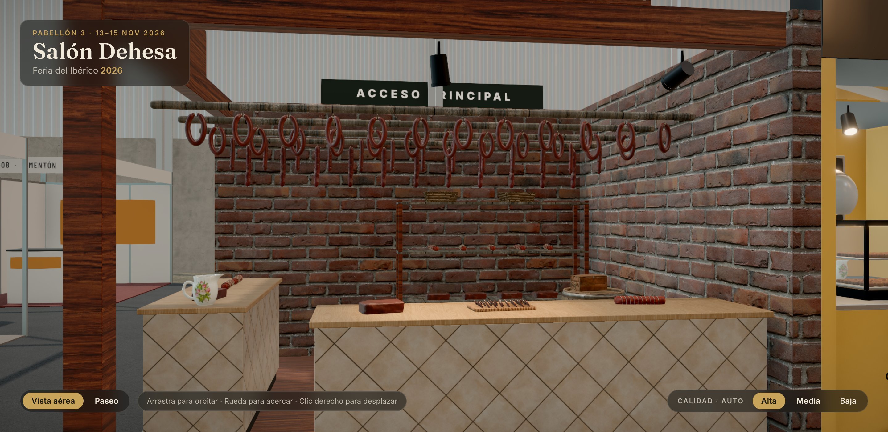

# Embutidos Sierra Candela · Embutidos

> Esquina de 18 m² con dos frentes: secadero de ladrillo visto con una cortina de chorizos y
> salchichones colgados de varales, mostrador de azulejo en L y estantería de curados.

## Ficha

| | |
|---|---|
| Código de parcela | D-53 |
| Tipo y tamaño | Esquina · mediano · 4,5 × 4 m (18 m²) |
| Parcela (pabellón) | x −0,5 … 4, z 2 … 6 |
| Lados a pasillo | Norte (Avenida Central) y este (Calle 3) |
| Frente principal | Norte |
| Altura máxima | 3,5 m |
| Estado | Terminado (fase 5) |

## Expositor

- **Embutidos Sierra Candela**: «Chacina ibérica curada al aire de la sierra». Desde 1974, Sierra
  de Aracena.
- Chorizo, salchichón, lomo y cecina de ibérico embutidos a mano y curados en secadero natural
  con pimentón de la Vera.
- **Identidad:**
  - Tipografía Alfa Slab One.
  - Pimentón `#a3261b`, tabaco `#3b2518`, ocre `#d19a3a`, papel `#f1e4cf`.

## Arquitectura

- **Suelo:** madera oscura, 0,08 m.
- **Muros:** ladrillo visto de 3,0 m en los dos lados cerrados.
- **Estructura:** poste de esquina y vigas de madera oscura a 3,0 m.
- **Varales:** cuatro, a 2,5 m de alto.
- **Frontis:** retroiluminados, apoyados sobre las vigas y orientados a los dos pasillos, con el
  nombre y «Chacina ibérica · desde 1974».

## Mobiliario y producto

- **Cortina de embutidos:** 48 piezas instanciadas. De atrás adelante:
  - 11 salchichones;
  - 13 chorizos vela;
  - 2 × 12 chorizos en sarta.
- **Mostrador de azulejo en L,** de 1,0 m de alto y tapa de roble:
  - Frontal de 2,9 × 0,65 m con tabla de embutidos, lomos y cecinas.
  - Lateral de 0,65 × 2,0 m con lomos, cecinas y jarra.
- **Estantería del fondo:** 2,2 × 0,42 × 1,8 m, con lomos, cecinas y cestas.
- **Decoración:** barrica y caja de madera.

## Iluminación

- **Luz real:** un foco.
- **Decorativo:** otro foco más.

## Archivos

- **Configuración:** `src/config/stands/embutidos.ts`.
- **Cotas y colisiones:** `EMBUTIDOS` en `src/config/layouts.ts`.
- **Escena:** `src/scene/stands/EmbutidosStand.tsx`.
- **Modelos** (`blender/build_products.py`): `chorizo_sarta`, `chorizo_vela`, `salchichon`,
  `lomo`, `cecina` y `tabla_embutidos`.

## Pendiente

- Nada funcional.
- Su lado este da a la Calle 3, justo enfrente del chigre de Llagar Pumarín.
