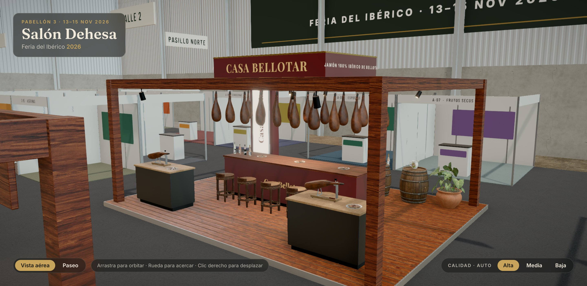

# Casa Bellotar · Jamón

> Isla de 48 m² con la marca insignia de la feria: bodega de jamones bajo una pérgola de roble
> oscuro, barra de degustación y dos puestos de corte a cuchillo.

## Ficha

| | |
|---|---|
| Código de parcela | C-50 |
| Tipo y tamaño | Isla · grande · 8 × 6 m (48 m²) |
| Parcela (pabellón) | x −4 … 4, z −8 … −2 |
| Lados a pasillo | Los cuatro: Pasillo Norte, Avenida Central, Calles 2 y 3 |
| Frente principal | Sur (Avenida Central) |
| Altura máxima | 4,5 m |
| Estado | Terminado (fase 5) |

## Expositor

- **Casa Bellotar**: «Jamón 100% ibérico de bellota». Desde 1962, Dehesa de Sierra Morena.
- Tres generaciones criando cerdo ibérico en libertad y curando jamones un mínimo de 36 meses
  en bodega natural.
- **Productos:**
  - Jamón de bellota 100% ibérico.
  - Paleta de bellota.
  - Jamón cortado a cuchillo.
- **Identidad:**
  - Tipografía Playfair Display 700.
  - Granate `#5a1a1f`, marrón `#2a1512`, oro `#c9a45c`, papel `#efe6d6`.

## Arquitectura

- **Tarima:** madera de 0,12 m de alto en toda la parcela.
- **Pérgola:**
  - Cuatro postes de roble oscuro de 20 × 20 cm hasta 3,30 m.
  - Vigas perimetrales, dos vigas de colgar y viguetas.
- **Corona de marca:** 3,4 × 0,55 × 2,2 m sobre la pérgola.
- **Tótem luminoso:** doble cara, 4,2 m de alto, en la esquina noroeste.

## Mobiliario y producto

- **Jamones colgados:** 18, en dos filas de 9 bajo las vigas (`jamonColgado`, instanciados).
- **Barra de degustación central:**
  - Mide 4,2 × 0,9 m y 1,10 m de alto, con tapa de madera oscura.
  - Diez taburetes de barra, cinco por lado (`tabureteBarra`).
  - Platos de jamón y botellas de vino.
- **Dos puestos de corte:**
  - Cuerpo lacado en negro con tapa de roble, 1,5 × 0,7 × 1,0 m.
  - Jamón empezado sobre jamonero (`jamonCortado` + `jamonero`, montados por `HamOnStand`) y
    plato de loncheado.
- **Rincón de barricas:** dos barricas con botellas y jarra, y una planta grande.

## Iluminación

- **Luz real:** un solo foco sobre la barra.
- **Decorativos:** los focos de los puestos de corte y los demás llevan `light={false}`.
- **Tótem:** caja de luz.

## Archivos

- **Configuración:** `src/config/stands/jamon.ts`.
- **Cotas y colisiones:** `JAMON` en `src/config/layouts.ts`.
- **Escena:** `src/scene/stands/JamonStand.tsx` y `src/scene/products/HamOnStand.tsx`.
- **Modelos:**
  - `blender/build_products.py`: `jamon_colgado`, `jamon_cortado` y `plato_jamon`.
  - `blender/build_models.py`: `jamonero`.

## Pendiente

- Nada funcional.
- Con la nueva vista inicial (desde el noreste), el stand de vinos tapa en parte la mitad este
  de la isla. Hay que confirmarlo a ojo.
