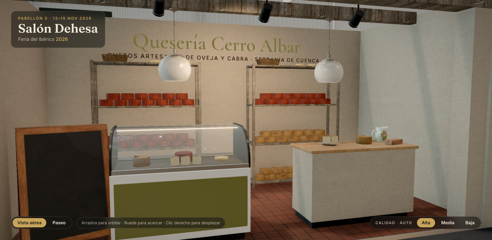

# Quesería Cerro Albar · Quesos

> Stand lineal de 18 m²: quesería artesana encalada con suelo de barro, dintel de madera,
> estanterías de maduración, vitrina refrigerada y mostrador de cata.

## Ficha

| | |
|---|---|
| Código de parcela | D-51 |
| Tipo y tamaño | Lineal · mediano · 6 × 3 m (18 m²) |
| Parcela (pabellón) | x −9,5 … −3,5, z 2 … 5 |
| Lados a pasillo | Norte (Avenida Central) |
| Frente principal | Norte |
| Altura máxima | 3,5 m |
| Estado | Terminado (fase 5) |

## Expositor

- **Quesería Cerro Albar**: «Quesos artesanos de oveja y cabra». Desde 1987, Serranía de
  Cuenca.
- Leche cruda de rebaño propio, cuajo natural y maduración lenta sobre tablas de pino en
  cámara de piedra.
- **Productos:**
  - Queso curado de oveja.
  - Queso semicurado.
  - Queso de cabra en aceite.
  - Torta cremosa.
- **Identidad:**
  - Tipografía Cormorant Garamond 600.
  - Oliva `#6b6b3a`, teja `#b5653a`, trigo `#e2c98f`, papel `#f3ecdc`.

## Arquitectura

- **Suelo:** barro cocido, 0,06 m.
- **Paredes:** encaladas de 3,0 m en el fondo y los dos laterales.
- **Frente:**
  - Pilares encalados de 28 cm hasta 2,8 m.
  - Dintel de madera rústica y viga de lámparas.
- **Rótulo:** pintado en la pared del fondo.

## Mobiliario y producto

- **Dos estanterías de maduración:** 1,7 × 0,42 m y 2,2 m de alto, con ruedas de queso, tortas y
  cestas de mimbre.
- **Vitrina refrigerada** (`vitrinaRefrigerada`):
  - Frente con el color de marca.
  - Surtida con queso cortado, cuñas, torta y queso al pimentón.
- **Mostrador de cata:**
  - Mide 1,5 × 0,6 × 1,0 m, con cuerpo encalado y tapa de roble.
  - Encima: tabla de servir, cuñas, queso empezado, caja de queso y jarra.
- **Decoración:** caja de madera con quesos curados, pizarra de caballete y lámparas colgantes.

## Iluminación

- **Luz real:** un solo foco, que baña las dos estanterías.
- **Decorativos:** el resto de focos.

## Archivos

- **Configuración:** `src/config/stands/quesos.ts`.
- **Cotas y colisiones:** `QUESOS` en `src/config/layouts.ts`.
- **Escena:** `src/scene/stands/QuesosStand.tsx`.
- **Modelos:**
  - `blender/build_products.py`: `queso_curado`, `queso_pimenton`, `queso_cortado`, `cuna_queso` y
    `torta`.
  - `blender/build_models.py`: `vitrina_refrigerada`.

## Pendiente

Nada.
